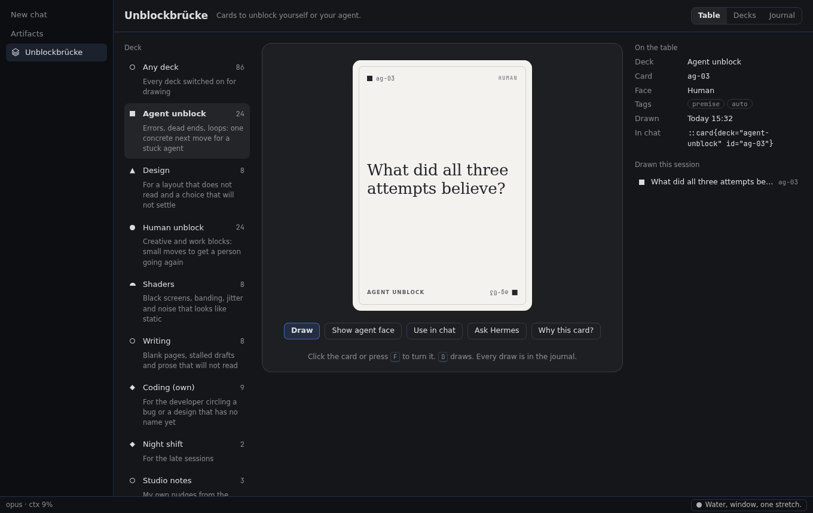
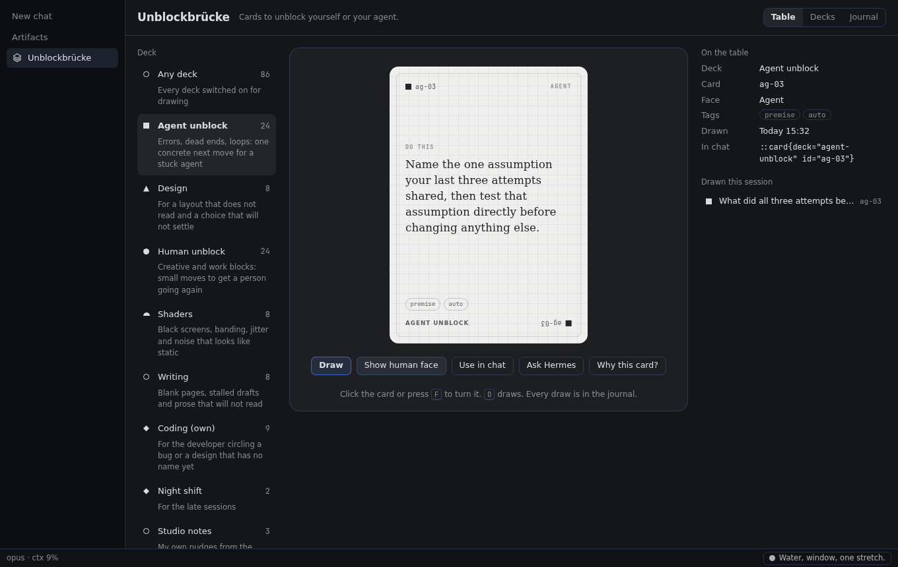
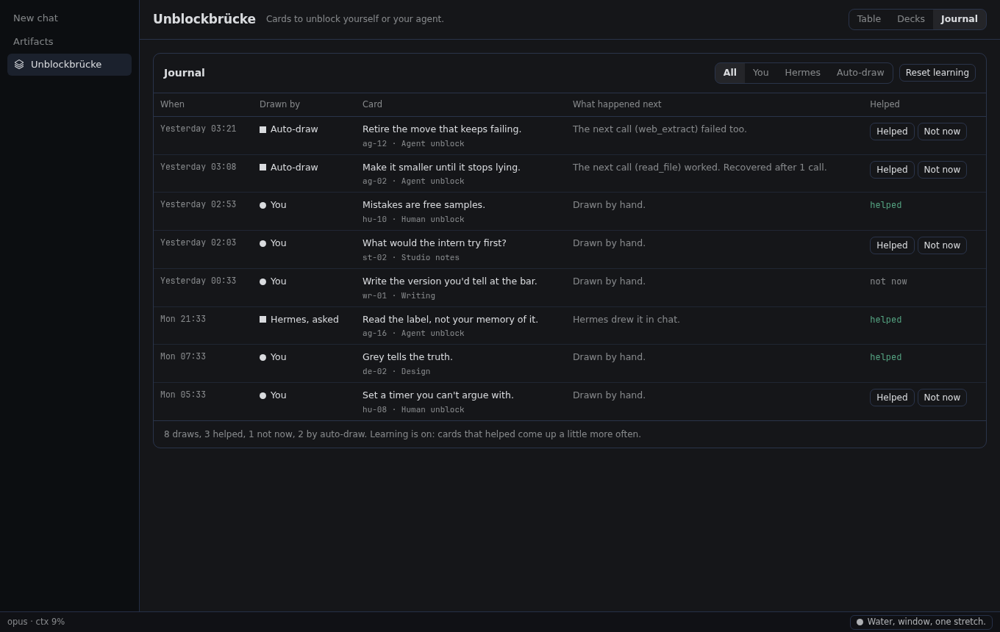
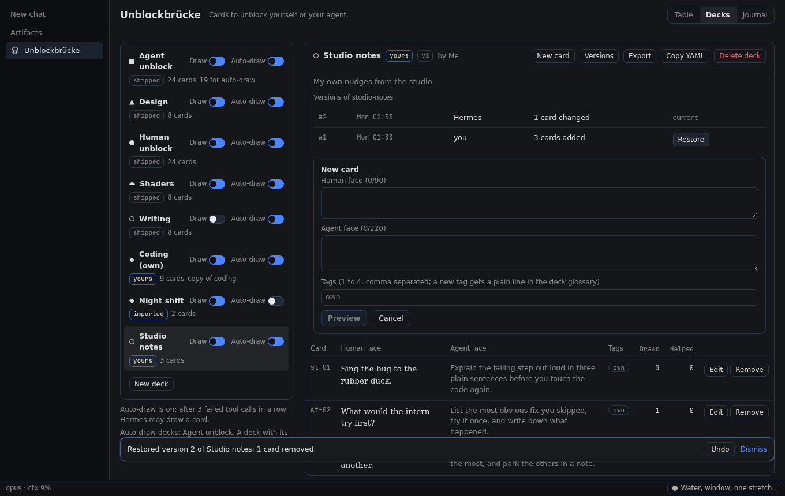
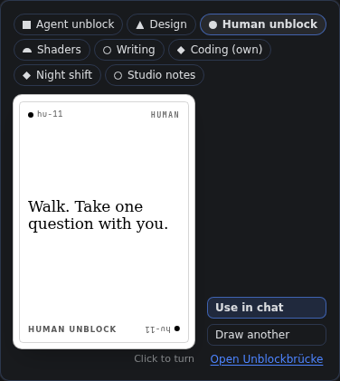

# Unblockbrücke

Cards to unblock yourself or your agent.



Every card has two faces: a short line for you, and one concrete instruction for an agent. Draw one
when you are blocked. Switch on auto-draw, and Hermes draws one for itself after three failed tool
calls in a row. A free, playful member of the Studio Luftbrücke plugin family.

The cards are written new for Hermes, in the spirit of Brian Eno and Peter Schmidt's Oblique
Strategies. The original Oblique Strategies are not included.

## What it does

- **A card table in Hermes Desktop.** Pick a deck, draw, turn the card over (click it or press F).
  **Use in chat**, **Ask Hermes** and **Why this card?** take it further.
- **Auto-draw for your agent (off by default).** When tool calls fail in a row, the failing result
  that reaches the count carries one card. The call still counts as failed: the card adds a
  direction and never hides an error.
- **Six decks, 80 cards.** Agent unblock (24), Human unblock (24), and Coding, Design, Shaders and
  Writing (8 each). Cards you mark **Helped** come up a little more often; the journal keeps every
  draw.
- **Your own decks.** Write decks on the page or ask Hermes, preview each change before you save it,
  restore an earlier version, import and export YAML.
- **Cards everywhere.** Card of the day in the status bar, `/card` in any chat (no model call), the
  command palette and ⌘⌥U (Ctrl+Alt+U), and inline cards with `::card{deck="coding" id="co-03"}`.

| Agent face | Journal | Your decks | Card of the day |
| --- | --- | --- | --- |
|  |  |  |  |

## Install and update

```bash
hermes plugins install https://github.com/studioluftbruecke/hermes-unblockbruecke --enable
```

Hermes Desktop loads the card table, chip and settings page (`desktop/plugin.js`) from the computer it
runs on, never from a Hermes on a server. With Hermes on a server, install and update the plugin in
both places, on the same version. With Hermes and Desktop on one computer, one install covers both.

| Where | Install | Update |
| --- | --- | --- |
| Server: tools, hooks, routes | `hermes -p <profile> plugins install https://github.com/studioluftbruecke/hermes-unblockbruecke --enable` | `hermes -p <profile> plugins update unblockbruecke` |
| Desktop computer: card table, chip and settings page | `hermes plugins install https://github.com/studioluftbruecke/hermes-unblockbruecke` | `hermes plugins update unblockbruecke` |

- After either step on the Desktop computer: Capabilities → Plugins → Rescan. A new install's
  Desktop half arrives switched off; switch it on there.
- No Hermes on the Desktop computer: Capabilities → Plugins → Install from Git with the URL; to
  update, the same with Advanced → Force reinstall. Desktop's Update button updates the server only.
- After an update on the server, Desktop chats and the plugin's routes keep the old code: in
  Capabilities → Plugins, switch **Agent in <profile>** off and on, then start a new chat.
- Same version in both places? Compare the Version column of `hermes plugins list` on the Desktop
  computer and `hermes -p <profile> plugins list` on the server.

## First use

1. Install the plugin and switch its Desktop half on (above).
2. Open **Unblockbrücke** in the sidebar, pick a deck and press **Draw**. Or type `/card` in any chat.
3. To let Hermes draw for itself, switch on **Hermes draws when stuck** in
   Settings ▸ Plugins ▸ Unblockbrücke ▸ Agent settings.

## Settings

Settings ▸ Plugins ▸ Unblockbrücke opens the plugin's **Decks and learning** page: the per-deck
**Draw** and **Auto** switches and **Reset learning**. The settings below sit beneath it in
**Agent settings**.

| Setting | Default | What it does |
| --- | --- | --- |
| `autodraw` | off | Hermes draws a card when tool calls fail in a row in one turn |
| `autodraw_threshold` | 3 | Failed tool calls in a row that bring a card (2 to 6) |
| `autodraw_per_turn` | 1 | Auto-drawn cards per turn at most (1 to 3) |
| `autodraw_decks` | `["agent-unblock"]` | Decks Hermes may draw from; each deck's own Auto switch must be on too |
| `card_of_day` | on | One Human unblock card a day in the status bar |
| `learning` | on | Cards rated Helped come up a little more often; none disappears |
| `show_in_sidebar` | on | The Unblockbrücke row in the Desktop sidebar |

When nobody is at the keyboard (scheduled jobs, `hermes chat -q`), cards that ask a person
something are skipped, and the agent cannot change your decks.

## Your agent

| Tool | What it does |
| --- | --- |
| `unblockbruecke_card` | Draw a card, list decks, show a card, read the journal, rate a draw |
| `unblockbruecke_decks` | Edit decks: preview a change, save it with a version, restore, switch, import, export |

The bundled skill `unblockbruecke:unblockbruecke` tells the agent when to offer a card and how to
coach with one.

## Disclosures

- **Network calls:** none. The Desktop half talks only to this plugin's routes on your own Hermes
  backend (`/api/plugins/unblockbruecke/...`).
- **Files:** everything lives in the plugin's data folder
  (`<profile>/plugin-data/agent-plugin-unblockbruecke-…`): your decks and their last 20 versions,
  the deck switches, and the journal of draws (one JSONL file per month, only ever appended). The
  agent writes a deck file elsewhere only when it exports to a path you name.
- **Agent context:** with auto-draw on, the text of one card from the decks you allow is added to a
  failing tool result, so the model reads it. A card the agent draws on request enters its context
  the same way.
- **Shell commands, child processes, scheduled jobs:** none.
- **Bundled data:** the six decks in `data/decks/`. The plugin contains no text of the original
  Oblique Strategies and no data derived from it; the maintainer checks every deck against them
  before it ships. `desktop/plugin.js` (66 KB) is built from `desktop/src` by `desktop/build/`
  (`npm ci && node build.mjs`). Hermes' install scan says `safe`; its medium findings are esbuild's
  character escapes in the bundle and the word `sudo` in the rule that refuses it in cards.
- **Credentials:** none.
- **Telemetry:** none.

## Uninstall

```bash
hermes plugins remove unblockbruecke
```

On a server, run it there with `-p <profile>` and on the Desktop computer. Your decks and journal stay
in the profile's plugin data folder; delete that folder to remove them too.

## Contributing

Propose a deck or a fix as a pull request: [`CONTRIBUTING.md`](CONTRIBUTING.md) explains the deck
file, the rules and how pull requests land. `scripts/check_deck.py` checks a deck.

## License

Code: MIT, see `LICENSE`. Deck texts: CC BY 4.0 for the shipped decks, CC BY 4.0 or CC0 for
community decks, see `DECKS-LICENSE.md`.
